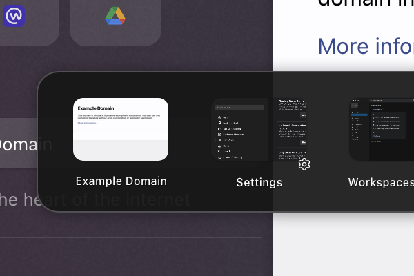
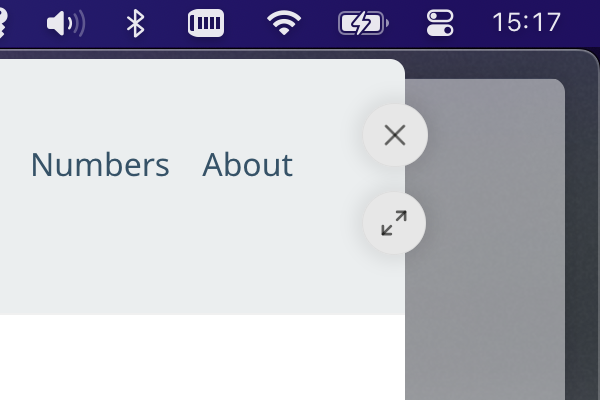
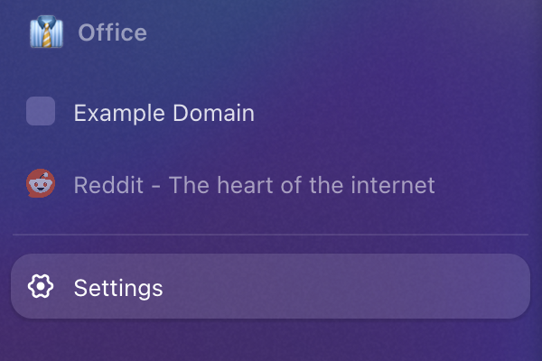
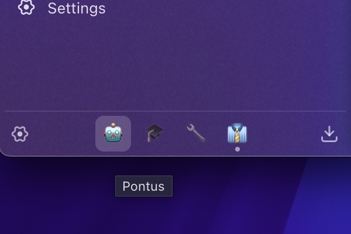

# Zen Browser Mods

Some mods for the Zen Browser. Install them with [Sine](). Paste the URL for the relevant folder, for example `psu/zen-mods/tree/main/better-ctrl-tab`. 

 

## Better CtrlTab Panel

Re-style and add customization options for the CtrlTab panel.

The CtrlTab panel **is off by default**. This mod requires you to first enable it in Zen's settings. 

⤓ Install with `psu/zen-mods/tree/main/better-ctrl-tab`

Use the preference "Zoom" to adjust panel size and avoid clipping.

]

 

## Right Side Glance Buttons

Move the _at a glance_ buttons to the right side of the window.

[⤓ Install](https://zen-browser.app/mods/20e8cc78-3dac-4db0-81a4-814672fb50af/)

 

## Tab title fixes

Increase size of tab titles and add make pending tabs standing out more.

[⤓ Install](https://zen-browser.app/mods/7190e4e9-bead-4b40-8f57-95d852ddc941/)

 

## Better Workspace Buttons

Re-style and add customization options for the Workspace Buttons.

 

---

Pontus Sundén, 2025 - [hi@pontus.cc](mailto:hi@pontus.cc)
