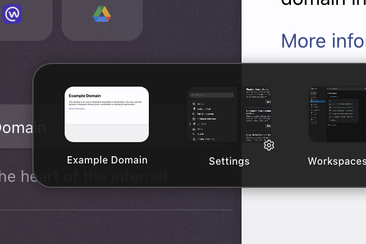

# Zen Mod: Better CtrlTab Panel

Re-style and add customization options for the CtrlTab panel.

[Source code at GitHub](https://github.com/psu/zen-mods)

Requires the Ctrl+Tab panel to be turned on: Settings > Tabs and Browsing > "Ctrl+Tab cycles through tabs in recently used order" (`browser.ctrlTab.sortByRecentlyUsed`).

## v3.1 - Changes

- Fixed Zen's grey panel showing around the mod's panel (use the renamed Firefox panel variables)
- Fixed previews overflowing their tile on smaller screens (previews now fill Zen's grid instead of a fixed 311.25px tile)
- Fixed preference _Panel - Adjust Vertical Position_ having no effect
- Removed Zen's default border around the favicon

## v2 - Changes

- Fixed missing preference _Item - Padding_
- Remove preference _Panel - Zoom_
- Added preference _Panel - Border Color_
- Added preference _Panel - Border Width_
- Added preference _Panel - Max-width_
- Added preference _Panel - Adjust Vertical Position_
- Added preference _Item Label - Color_
- Added preference _Item Label - Font Family_
- Added preference _Item Label - Font Weight_
- Added preference _Item Label - Width Overflow_
- Added preference _Item Favicon - Background_
- Update _Favicon - Outdent_ to moves along a diagonal across the preview, set to -150px to position it top-left (instead of Zen's default bottom-right)
